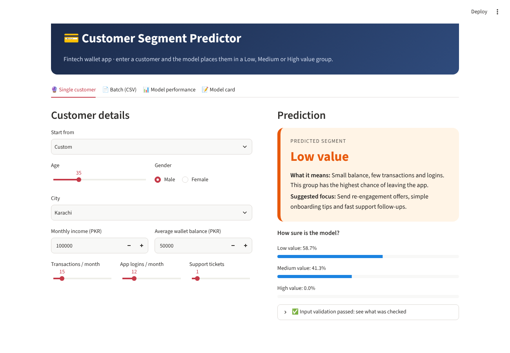

# Fintech Customer Segmentation: End-to-End ML Pipeline

A beginner-friendly, reproducible machine learning project on a made-up digital wallet app.

**Pipeline:** 3 Excel tables -> SQLite + SQL JOINs -> cleaning and scaling -> K-Means and DBSCAN clustering -> classification of the cluster labels -> tuning and evaluation -> saved `.joblib` pipeline -> input validation -> model card -> Streamlit app.

**GitHub:** [https://github.com/1AbdullahButt/fintech-customer-segmentation-pipeline](https://github.com/1AbdullahButt/fintech-customer-segmentation-pipeline)

**Live app:** [https://fintech-customer-segmentation-pipeline.streamlit.app/](https://fintech-customer-segmentation-pipeline.streamlit.app/)

[](https://fintech-customer-segmentation-pipeline.streamlit.app/)



## What is in this folder
| File | What it is |
|---|---|
| `fintech_ml_pipeline.ipynb` | The full notebook (runs top to bottom, also on Google Colab) |
| `customers.xlsx`, `accounts.xlsx`, `support_tickets.xlsx` | The three original datasets (linked by `customer_id`) |
| `fintech.db`, `fintech_database.sql` | SQLite database and its SQL script |
| `master_dataset.csv`, `master_clustered.csv` | The joined table, before and after adding the cluster labels |
| `mysql_code.sql`, `mysql_join.sql` | The same tables and JOIN written for MySQL (screenshots in `screenshots/`) |
| `cluster_model.joblib` | Saved full pipeline (scaling + encoding + model) |
| `input_schema.json`, `validation.py` | Input schema and the validation code |
| `MODEL_CARD.md` | Model card |
| `metrics.json`, `confusion_matrix.png` | Evaluation results used by the app |
| `app.py`, `sample_batch.csv` | Streamlit app and a sample CSV for it |
| `requirements.txt` | Python packages needed to run the app |
| `docs/business_queries.md` | 10 business questions answered with SQL |

## Requirements
- **Python 3.12 or newer** (tested with 3.12-3.14). Python 3.11 and older will not work: the pinned `numpy==2.5.3` needs Python 3.12+, so `pip install` fails with "No matching distribution found".
- Git (or download the repository as a ZIP from GitHub and unzip it).

Check your version with `python --version` (Windows) or `python3 --version` (macOS / Linux).

## Run the Streamlit app locally
1. Get the code and go into the folder:
```
git clone https://github.com/1AbdullahButt/fintech-customer-segmentation-pipeline.git
cd fintech-customer-segmentation-pipeline
```
2. Create and turn on a virtual environment (so the pinned versions do not clash with other projects).

   Windows (PowerShell or Command Prompt):
```
python -m venv .venv
.venv\Scripts\activate
```
   macOS / Linux:
```
python3 -m venv .venv
source .venv/bin/activate
```
   If PowerShell blocks the activate script, run `Set-ExecutionPolicy -Scope CurrentUser RemoteSigned` once, or use Command Prompt.

3. Install the packages and start the app (same commands on every system, with the virtual environment turned on):
```
pip install -r requirements.txt
streamlit run app.py
```
Run `streamlit run app.py` from inside the project folder: the app loads `cluster_model.joblib`, `input_schema.json`, `metrics.json`, `sample_batch.csv` and `MODEL_CARD.md` from the current folder.

The app opens in your browser at http://localhost:8501 (if it does not open by itself, go to that address). Stop it with Ctrl+C in the terminal.

If you get a scikit-learn version error when loading the model, rebuild `cluster_model.joblib` by running the notebook **locally** with the same packages as the app (see below). Running it on Colab does not help here: Colab uses its own scikit-learn version, and the files it makes stay on Colab.

## Run the notebook
### On Google Colab
1. Go to colab.research.google.com -> File -> Upload notebook -> choose `fintech_ml_pipeline.ipynb`.
2. Runtime -> Run all. The notebook creates the datasets, the database and the model itself, so no uploads are needed.

### Locally
With the virtual environment from above turned on:
```
pip install notebook
jupyter notebook fintech_ml_pipeline.ipynb
```
Then Run -> Run All Cells. Note: the notebook writes its outputs into the project folder and **overwrites** the committed files (`customers.xlsx`, `accounts.xlsx`, `support_tickets.xlsx`, `fintech.db`, `fintech_database.sql`, the two CSVs, `cluster_model.joblib`, `input_schema.json`, `metrics.json`, `confusion_matrix.png`, `MODEL_CARD.md`). It also creates `fintech_part2.db`, which is ignored by Git.

## Live app and repository
- Live app on Streamlit Community Cloud (deployed from `app.py` on `main`): https://fintech-customer-segmentation-pipeline.streamlit.app/ - if it has been idle, Streamlit shows a "wake up" button first.
- Source: https://github.com/1AbdullahButt/fintech-customer-segmentation-pipeline

To publish your own copy, fork the repository on GitHub (or create a new empty repository and push this folder to it with `git remote set-url origin <your repo URL>` then `git push -u origin main`), and deploy `app.py` from it on share.streamlit.io.

## Important note
The data is synthetic and the cluster labels come from K-Means on almost the same columns, so scores near 100% are expected. This project demonstrates the pipeline, not real-world accuracy. See `MODEL_CARD.md`.
