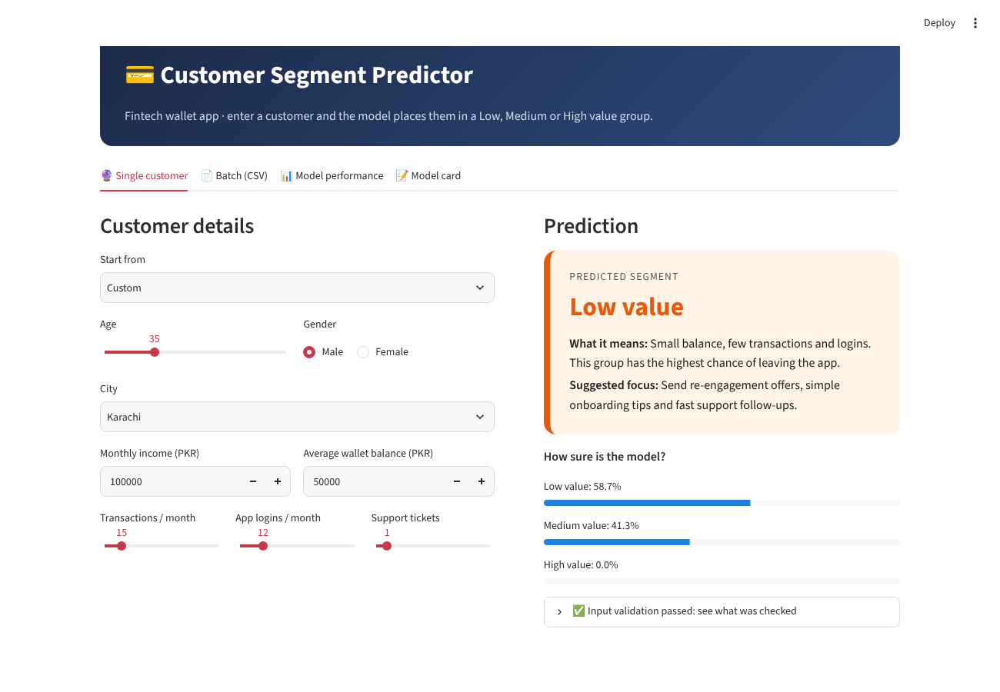

# Fintech Customer Segmentation: End-to-End ML Pipeline

A beginner-friendly, reproducible machine learning project on a made-up digital wallet app.

**Pipeline:** 3 Excel tables -> SQLite + SQL JOINs -> cleaning and scaling -> K-Means and DBSCAN clustering -> classification of the cluster labels -> tuning and evaluation -> saved `.joblib` pipeline -> input validation -> model card -> Streamlit app.



## What is in this folder
| File | What it is |
|---|---|
| `fintech_ml_pipeline.ipynb` | The full notebook (runs top to bottom, also on Google Colab) |
| `customers.xlsx`, `accounts.xlsx`, `support_tickets.xlsx` | The three original datasets (linked by `customer_id`) |
| `fintech.db`, `fintech_database.sql` | SQLite database and its SQL script |
| `mysql_code.sql`, `mysql_join.sql` | The same tables and JOIN written for MySQL |
| `cluster_model.joblib` | Saved full pipeline (scaling + encoding + model) |
| `input_schema.json`, `validation.py` | Input schema and the validation code |
| `MODEL_CARD.md` | Model card |
| `metrics.json`, `confusion_matrix.png` | Evaluation results used by the app |
| `app.py`, `sample_batch.csv` | Streamlit app and a sample CSV for it |
| `docs/business_queries.md` | 10 business questions answered with SQL |

## Run the notebook on Google Colab
1. Go to colab.research.google.com -> File -> Upload notebook -> choose `fintech_ml_pipeline.ipynb`.
2. Runtime -> Run all. The notebook creates the datasets, the database and the model itself, so no uploads are needed.

## Run the Streamlit app (Windows)
```
pip install -r requirements.txt
streamlit run app.py
```
The app opens in your browser. If you get a scikit-learn version error when loading the model, run the notebook once to rebuild `cluster_model.joblib`.

## Put it on GitHub
1. Create a new empty repository on github.com.
2. Upload all files in this folder (Add file -> Upload files), or from a terminal:
```
git init
git add .
git commit -m "End-to-end ML pipeline"
git branch -M main
git remote add origin https://github.com/1AbdullahButt/fintech-customer-segmentation-pipeline.git
git push -u origin main
```
3. Optional: deploy the app free on share.streamlit.io by pointing it at `app.py`.

## Important note
The data is synthetic and the cluster labels come from K-Means on almost the same columns, so scores near 100% are expected. This project demonstrates the pipeline, not real-world accuracy. See `MODEL_CARD.md`.
